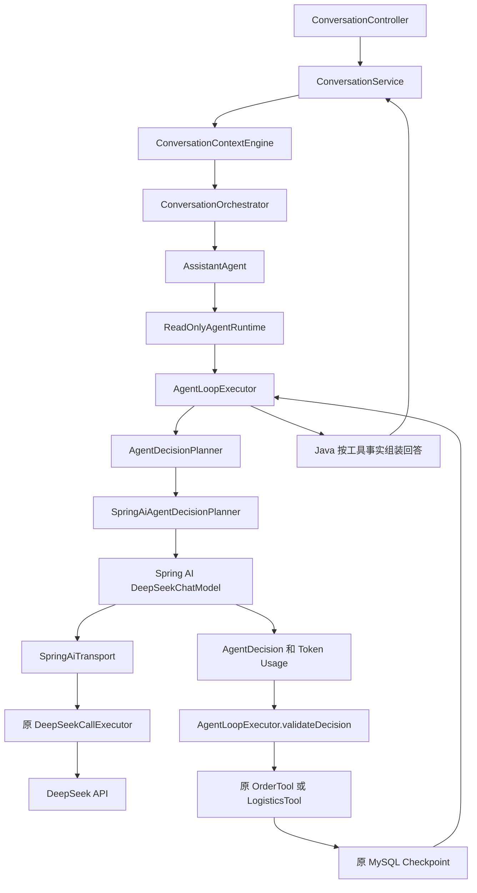

# Spring AI 与持久化 Agent 的集成

本次集成使用 Java 21、Spring Boot 4.0.8 和 Spring AI 2.0.2，保留原来的业务入口、Agent 执行器、数据库结构和知识检索。默认 `supportflow.ai.planner=custom`。新增实现通过真实的 Spring AI DeepSeekChatModel、ChatClient 和 RestClient 请求链工作，专项测试替换最后一层 HTTP 客户端，不调用付费接口。

## 配置与回退

后端密钥沿用 `supportflow.ai.deepseek.api-key=${DEEPSEEK_API_KEY:}`。在本机或部署系统的私密环境中设置 `DEEPSEEK_API_KEY`，不要写入 Git、启动命令截图或诊断输出。

在现有本地启动配置激活的前提下，增加以下程序参数并重启该后端进程即可选择新规划器。

```text
--supportflow.ai.deepseek.enabled=true
--supportflow.ai.planner=spring-ai
```

也可以设置 `SUPPORTFLOW_AI_PLANNER=spring-ai`。回退时设置 `custom`，其他模型开关沿用原配置。`custom` 且 DeepSeek 关闭时继续使用离线规则规划器。新模式要求显式开启 DeepSeek 并配置合法密钥，缺少条件会启动失败，不会偷偷切回另一种计费路径。

Spring AI 自动模型和默认 ChatClient 在应用启动入口显式排除，同时主配置设置 `spring.ai.model.chat=none`、`spring.ai.chat.client.enabled=false`。因此即使测试或部署替换整个主配置文件，starter 也不会装配未受保护的客户端。本项目的条件配置负责装配有保护的客户端。当前模型名和价格模型保持原配置，修改模型时仍须同步配置并确认 `supportflow.agent.runtime.pricing-model` 与费率。

公开资料筛选还沿用 `supportflow.rag.enabled` 和 `supportflow.rag.public-evidence-selection-enabled` 开关。BGE 的模型准备要求见 [语义检索](semantic-rag.md)，本次不会为了展示 ChatClient 而自动开启 BGE 或扩大外发授权。

## 当前调用链



知识路径为 `KnowledgeService → 当前店铺 Hybrid Retrieval → SpringAiKnowledgeAdapter → ChatClient → DeepSeekChatModel → 同一保护层`。只有满足现有公开参考目录和问题外发规则的候选才进入 ChatClient。商家私有知识继续在本地检索和组合回答。

## 为什么保留自研 Agent Loop

Spring AI 管理模型协议、DeepSeek provider、消息与工具定义、结构化输出和观测。本项目的运行时继续管理持久化状态、检查点、Token 与估算费用预留、原始 Deadline、Generation/Lease、权限、工具顺序、幂等调用标识、有限重试和人工批准边界。

`AgentLoopExecutor` 没有交给框架执行。模型建议必须经过现有 `validateDecision`，实际订单查询仍传入服务器认证买家和当前运行绑定的店铺，执行前复核订单归属。退款、审批、收货和其他写操作继续在原 Java 服务中完成。

| Spring AI 能力 | 当前接入位置 | 原实现的处理方式 |
| --- | --- | --- |
| ChatModel / DeepSeekChatModel | `SpringAiAgentDecisionPlanner` | 新模式替代手写 messages/tools 协议与响应封装；原规划器可切回 |
| ToolDefinition / ToolCallback | `SpringAiToolDefinitions` | 只提供 schema；实际执行保留原业务 Tool |
| Structured Output | `BeanOutputConverter<OrderArgument>`、`BeanOutputConverter<Selection>` | 映射 record 前严格检查 JSON 字段、重复键和类型，映射后继续进行业务校验 |
| ChatClient | 公开证据筛选真实业务 SPI | 以模型筛选允许的来源 ID，Java 保留完整条件和正文 |
| Document / DocumentRetriever | `SpringAiKnowledgeAdapter.forShop` | 复用 `KnowledgeService.searchEvidence` 与原 Hybrid RAG |
| ObservationRegistry | 模型、ChatClient 装配 | 使用当前应用注册表，原保护层指标继续有效 |
| Durable Runtime | 原 `AgentLoopExecutor` / `JdbcAgentRunStore` | 完整保留 |

## 防止双重工具执行

Spring AI 2.0.2 已将自动工具循环移到 ChatClient 的 ToolCallingAdvisor。规划器直接调用低层 ChatModel，只获得一次工具调用响应。另一个公开证据筛选用的 ChatClient 显式设置 `ChatClientAttributes.TOOL_CALLING_ADVISOR_AUTO_REGISTER=false`，也不注册自动工具循环。

工具定义按本轮状态提供，没有全局 `defaultTools`。`get_order`、`get_logistics` 是只读建议，`finish`、`clarify` 是运行控制建议。所有 schema-only callback 的 `call` 都拒绝执行，类中没有业务 Service 引用。即使后续错误地调用 callback，也无法执行订单或物流查询。实际业务工具只由原执行器调用。

模型参数仅有 `orderNo`。额外的 `buyerId`、`shopId`、`permission` 等字段会在协议边界拒绝。已有运行上下文继续持有认证买家和店铺，本版没有引入 Spring AI ToolContext。ToolContext 可传递非模型上下文，但此处将框架再次变成执行入口会增加授权路径，当前无需这样做。售后服务没有被注解或注册为模型工具。

## 防止双重 Retry，并复用原保护

DeepSeekChatModel 显式使用 Spring Framework 7 的 `new RetryTemplate(RetryPolicy.withMaxRetries(0))`。没有 StructuredOutputValidationAdvisor，也没有自动格式修复重试。格式错误直接安全失败。

`SpringAiTransport` 是 RestClient 的传输适配器。Spring AI 负责生成请求 JSON，适配器把这个实际请求交给原 `DeepSeekCallExecutor` 发送，从而共用原并发信号量、身份调用配额、熔断、HTTP 64 KiB 响应上限、完整响应超时、取消及安全日志。它不再额外发送 HTTP 请求。

每次调用创建当前线程私有的调用范围，绑定 operation、输入额度、剩余超时和响应检查器。该范围至多接受一次 provider 请求。即使将来误加 SDK retry 或 advisor loop，第二次请求也会在网络调用前拒绝。固定 HTTPS 地址、禁止重定向和原 HTTP 客户端均保留。

Provider 的 usage 和 tool-call 参数在原执行器的解析边界内严格验证，再交给 Spring AI 映射。异常 JSON、非法动作、身份伪造、超额 usage 不会被框架修复或转成有授权的决定。原运行时继续预留与结算预算，未知结果保留预留费用，重启不会补回额度。暂时性失败由原持久化重试策略决定，SDK 不额外重试。

## RAG 与数据外发

`RagKnowledgeSearch` 的算法、分块、BGE、RRF 融合、相似度阈值、缓存、MySQL 向量、版本与内容哈希均保留。没有引入替代的普通 VectorStore 或 QuestionAnswerAdvisor。

`forShop(shopId)` 用 Java 参数绑定店铺，调用当前 `KnowledgeService.searchEvidence`。它每次重新解析当前可见来源，忽略模型控制的 Query 上下文字段。Document 元数据保留 `sourceId`、`shopId`、`version`、`title`、`contentHash`。证据对象没有原始发布状态字段，因此以 `visibility=CURRENT_VISIBLE` 表示已经过原服务当前来源筛选，不虚构草稿或发布状态。

公开筛选再次比较候选和当前检索结果的完整 metadata 与正文。此前的受控公开目录精确比对和问题敏感字段检查由新旧实现共用。混合私有/公开候选整体拒绝外发；旧版本、伪造 `ref-*`、其他店铺来源不发送。模型返回的来源 ID 必须属于允许集合，重复、额外字段和错误类型均拒绝。失败保留原来的本地答案与审计证据。

规划器的数据外发范围沿用原边界，包括问题、选中的订单号、裁剪后的订单/物流观察。公开资料筛选限制不能扩大解释为所有模型入口都不含订单信息。详见 [项目边界](project-boundaries.md)。

## Memory、流式和可观测性

本版保留 `ConversationContextEngine` 的有限指代解析、有效期、重置和敏感动作不继承参数的规则。暂不引入 ChatMemory，避免普通历史文字被误当成业务授权或写入确认。

最终回答由 Java 根据工具事实或完整来源正文组合，再保存会话。原 SSE 继续输出这份已保存的结果。当前没有 Spring AI token-stream，底层 WebClient 的流式网络入口显式拒绝调用，防止绕过保护层。启用模型流式需另行实现受同样边界约束的取消、预算、错误与持久化协议。

| 观测对象 | 可信入口与解释 |
| --- | --- |
| 调用数、成功/失败、延迟、并发 | 原 `supportflow.ai.calls`、`supportflow.ai.call.duration`、`supportflow.ai.inflight`；SDK 不重复创建这套指标 |
| Spring AI 模型运行与 Token | 原应用 ObservationRegistry；starter 的 ChatModelMeterObservationHandler 读取 SDK usage |
| 预算和费用 | 原持久化 AgentBudget 与步骤记录；配置费率估算，非真实账单 |
| 工具决定、调用次数 | 原运行步骤/检查点与阶段日志；SDK 本身没有业务工具执行次数 |
| 关联排障 | 原服务器 traceId、持久化 agentRunId、AGENT_PLAN/ORDER_TOOL/LOGISTICS_TOOL 阶段日志 |

Spring AI operation observation 与原 provider-attempt 指标含义不同，不能相加当作请求次数。Prompt、completion 和原始异常日志默认关闭。完整跨服务 trace exporter 当前未配置，不能宣称已有生产级全链路追踪。

## 测试与验证

测试入口为 `SpringAiAgentDecisionPlannerTest`、`SpringAiConfigurationTest`、`SpringAiKnowledgeAdapterTest`、`SpringAiObservabilityTest`、`SpringAiAgentRuntimeIT`，并继续执行原有测试。新的测试经过实际 SDK 消息生成、模型映射与 RestClient，最后 HTTP 客户端返回合成响应。集成测试使用独立 MySQL 容器，日常库不参与。

```powershell
mvn -B -ntp test
mvn -B -ntp verify
```

如果本地运行进程占用既有 JAR，可用下面命令单独完成测试验收。这个参数只跳过 Spring Boot JAR 重打包，不跳过单元或集成测试。

```powershell
mvn -B -ntp "-Dspring-boot.repackage.skip=true" verify
```

CI 使用 `spring.test.context.cache.maxSize=4` 限制测试上下文缓存。本地长时间全量集成测试建议沿用该设置，减少已停止容器与缓存 Spring 上下文的资源清理交错。此次全量测试退出阶段的 Hikari 清理超时单列在审计记录中。

具体测试数量与本次验收结果见 [能力审计](ai-job-gap-audit.md)。这次没有使用真实付费 Key 或上传到 GitHub，也没有用合成响应结果宣称真实 DeepSeek 效果。

官方 API 对照为 [2.0 Tool Calling](https://docs.spring.io/spring-ai/reference/api/tools.html)、[DeepSeek](https://docs.spring.io/spring-ai/reference/api/chat/deepseek-chat.html) 和 [Structured Output](https://docs.spring.io/spring-ai/reference/api/structured-output/converters.html)。实现还核对了 Maven 中实际 2.0.2 sources，避免套用 1.x 的内部工具执行开关。

## 本次文件清单

| 范围 | 文件 |
| --- | --- |
| 新框架适配，目录 `src/main/java/dev/supportflow/ai/springai` | `SpringAiConfiguration.java`、`SpringAiProperties.java`、`SpringAiTransport.java`、`SpringAiToolDefinitions.java`、`SpringAiAgentDecisionPlanner.java`、`SpringAiKnowledgeAdapter.java` |
| 新专项验证，目录 `src/test/java/dev/supportflow/ai/springai` | `SpringAiTestProvider.java`、`SpringAiConfigurationTest.java`、`SpringAiAgentDecisionPlannerTest.java`、`SpringAiKnowledgeAdapterTest.java`、`SpringAiObservabilityTest.java`、`SpringAiAgentRuntimeIT.java` |
| 构建与配置 | `pom.xml`、`src/main/resources/application.yml`、`src/main/java/dev/supportflow/SupportFlowApplication.java` |
| 原 SPI 的条件装配及共用外发策略 | `src/main/java/dev/supportflow/chat/infrastructure/deepseek/DeepSeekConfiguration.java`、`DeepSeekPublicKnowledgeSelector.java`，以及 `src/main/java/dev/supportflow/assistant/knowledge/RagConfiguration.java` |
| 说明与审计 | `README.md`、`docs/project-overview.md`、`docs/interview-guide.md`、`docs/spring-ai-integration.md`、`docs/ai-job-gap-audit.md` |

工作树中先前已有的前端、Redis 和会话修改不计入本次接入文件清单。
